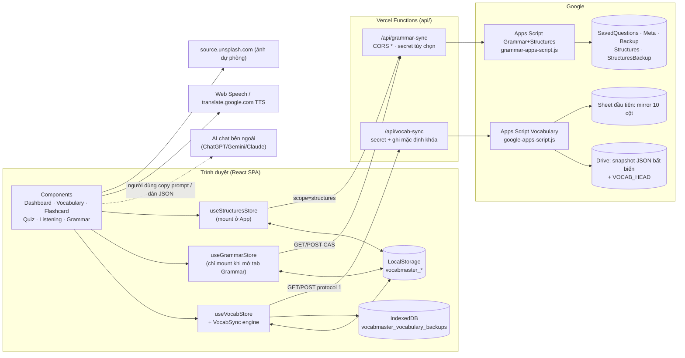
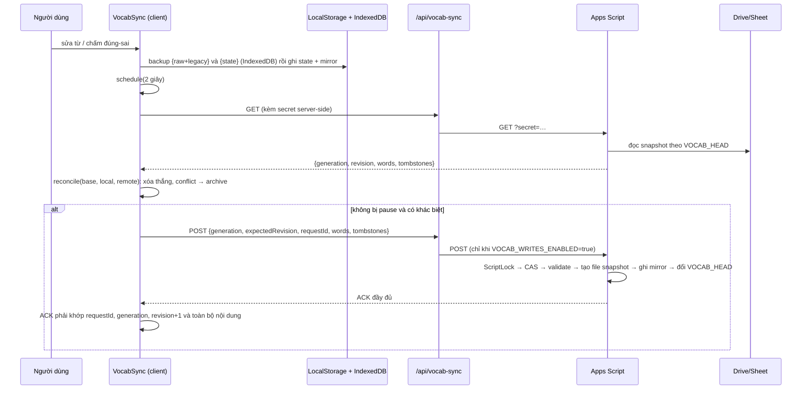

# Báo cáo phân tích dự án VocabMaster (thư mục `web toiec`)

- **Ngày khảo sát:** 2026-11-24 (commit đầu phiên `2ba0be3`, nhánh `main`, working tree sạch trước khi viết báo cáo).
- **Phạm vi:** chỉ đọc mã/tài liệu, chạy `npm run build`, `npm run lint` và 19 test Node không cần trình duyệt. Không sửa file mã, không gọi endpoint production, không chạm LocalStorage hay dữ liệu cloud.
- **Quy ước độ tin cậy:** nhận định kèm `file:dòng` là đã đối chiếu với mã. **"Ước tính"** = tôi tính từ mã, chưa đo thực tế. **"Chưa xác minh"** = không có bằng chứng trong repo (production, Google Sheets thật, trình duyệt thật, thiết bị cảm ứng).
- **Không đọc:** `node_modules/`, `dist/`, `.git/` (trừ `git log`/`git grep` để tìm rò rỉ bí mật), `package-lock.json`.

---

## 1. Tóm tắt tổng quan

### 1.1 Web làm gì, cho ai

VocabMaster là ứng dụng một trang (SPA) tự học tiếng Anh cho **người Việt**. Người học tự xây thư viện từ/cụm từ, ôn bằng flashcard, luyện nghe, và dùng **AI bên ngoài** (ChatGPT/Gemini/Claude) để tạo bài: app sinh prompt, người dùng dán JSON kết quả vào, app kiểm tra rồi cho học. App **không gọi API AI nào** (`src/components/Quiz.jsx:242`, `src/utils/grammarPrompt.js:33`).

**Mục tiêu hiện tại là VSTEP, nhưng sản phẩm đang ở trạng thái lai TOEIC/VSTEP:**

| Phần | Nhắm tới | Bằng chứng |
| --- | --- | --- |
| Grammar luyện mới | VSTEP B1–B2 (≈70% B1 / 30% B2) | `src/utils/grammarPrompt.js:33`, `src/components/Grammar.jsx:103` |
| Smart Quiz (Vocabulary, Structures) | Còn prompt **TOEIC Part 5** | `src/components/Quiz.jsx:111-234`, `src/utils/structureQuiz.js:9` |
| Vocabulary / Flashcard / Listening | Trung tính (từ do người dùng nhập) | `src/components/Vocabulary.jsx`, `Flashcard.jsx`, `ListeningReview.jsx` |
| Nhãn, meta | Còn "TOEIC" | `index.html:7`, `src/components/Dashboard.jsx:84`, `src/utils/audio.js:100` |

Không có module thi thử VSTEP đầy đủ (4 kỹ năng, đề theo passage, chấm Writing/Speaking, thang điểm). Đây là công cụ học từ vựng + phân tích câu, không phải bộ luyện đề.

### 1.2 Trạng thái hiện tại

- Mã chạy được: **build exit 0** (2.013 module, 15 s), **lint exit 0** (0 lỗi, 36 cảnh báo), **19/19 suite test Node đạt**. 9 test trình duyệt (Playwright + Edge) **chưa chạy** trong khảo sát này.
- Backend Vocabulary "protocol 1" **chưa triển khai production**; client/proxy/backend đều mặc định **khóa ghi** (`api/vocab-sync.js:13`, `google-apps-script.js:15`, `src/utils/vocabSync.js:180-184`). Vocabulary hiện chủ yếu là kho local + đọc cloud.
- Dự án vừa trải qua một sự cố mất/hồi sinh dữ liệu Vocabulary (xem `docs/VOCABULARY-RECOVERY.md`) và đã được viết lại sync rất cẩn thận. Phần lớn commit gần đây là sửa độ bền dữ liệu (`git log`: "quota recovery", "legacy vocab backups", "review save diagnostics").

### 1.3 Năm điểm mạnh

1. **Thiết kế sync Vocabulary chống mất dữ liệu bài bản:** generation + revision + tombstone, three-way merge "xóa thắng", ACK kiểm toàn bộ nội dung, snapshot Drive bất biến (`src/utils/vocabSync.js:47-83`, `google-apps-script.js:55-64`).
2. **Bảo toàn dữ liệu local:** lỗi lưu không biến thành "kho rỗng"; backup bất biến theo hash SHA-256 trong IndexedDB; rollback nhiều khóa khi ghi review thất bại (`src/utils/vocabBackup.js:29-43`, `src/utils/grammarStorage.js:98-136`).
3. **Ba kho dữ liệu tách bạch** (Vocabulary / câu Grammar / Structures), mỗi kho có khóa LocalStorage, revision và quy tắc merge riêng; Structures dùng event-sourcing (`reviewEvents`) nên merge offline không mất lượt trả lời (`src/utils/grammarSyncMerge.js:205-267`).
4. **Kiểm tra dữ liệu AI trả về rất kỹ ở Grammar:** parser chịu code-fence/lời dẫn, trích dẫn phải nằm nguyên văn trong câu, báo lỗi từng trường, chống trùng với toàn kho (`src/utils/grammarImport.js:20-74`).
5. **Độ phủ test cao cho logic khó:** 28 file test (~5.400 dòng), gồm mô phỏng Apps Script trong VM và test trình duyệt thật cho các lỗi từng xảy ra (`test/vocab-sync.test.js`, `test/structures-backend.test.js`, `test/vocab-quota-browser.test.js`).

### 1.4 Năm vấn đề lớn nhất

1. **URL Apps Script Vocabulary cũ nằm trong lịch sử git** (`6223f8f:src/config.js:11`) và repo có remote GitHub. Backend cũ nhận ghi không xác thực. Chưa xác minh repo public hay private. (Mục 8.1, Bảng 10 #1)
2. **Proxy Grammar không xác thực người dùng, CORS `*`, secret tùy chọn**: ai biết domain Vercel đều đọc/ghi được toàn bộ kho câu và Structures (`api/grammar-sync.js:44-46`, `grammar-apps-script.js:42-47`). (Bảng 10 #2)
3. **Tiến độ ôn Grammar nằm trong MỘT ô Google Sheets** (`Meta!B1`): ước tính hết giới hạn 50.000 ký tự/ô ở **~390 câu đã ôn**, sau đó mọi lần đẩy cloud thất bại (`grammar-apps-script.js:322-323`). (Bảng 10 #3)
4. **Backup IndexedDB tăng không giới hạn:** mỗi lần sửa/chấm một từ ghi 2 snapshot toàn kho, không bao giờ dọn; ước tính ~0,7 MB/lần với 600 từ (`src/utils/vocabSync.js:150-152`, `src/utils/vocabBackup.js`). (Bảng 10 #4)
5. **Không có Error Boundary, vài đường ghi có thể ném lỗi chưa bắt:** một lỗi quota trong `useEffect` hoặc `persistData` có thể làm trắng toàn app; thêm vào đó validator client lệch với backend (import level=7 → sync bị từ chối vĩnh viễn). (Bảng 10 #5, #6)

---

## 2. Công nghệ

| Hạng mục | Khai báo (`package.json`) | Cài thực tế (`node_modules`) |
| --- | --- | --- |
| Ngôn ngữ | JavaScript/JSX, ES modules (`"type": "module"`), **không TypeScript** | – |
| UI | `react`, `react-dom` `^19.2.8` | react 19.3.0 |
| Build | `vite ^8.3.0`, `@vitejs/plugin-react ^6.1.1` | vite 8.3.1 |
| CSS | `tailwindcss ^4.3.3` + `@tailwindcss/vite` | 4.3.3 |
| Icon | `lucide-react ^1.48.0` (đặt trong `devDependencies`, nhưng được bundle) | 1.48.0 |
| Xuất Excel | `write-excel-file ^4.1.1` (import động) | 4.1.1 |
| Lint | `oxlint ^1.81.0` + `.oxlintrc.json` (chỉ 2 rule tùy chỉnh, còn lại mặc định) | 1.86.0 |
| Test | **Không có framework**: script Node tự chạy (`node test/<tên>.test.js`) và `node:test`; test trình duyệt cần Playwright + Edge **không khai báo trong package.json** | – |
| Runtime khảo sát | Node v24.21.0, npm 11.19.0 (không có trường `engines`) | – |
| Hosting (suy ra) | Vercel Functions (`api/*.js`) + Google Apps Script + Google Sheets/Drive. **Không có `vercel.json`**; chưa xác minh cấu hình triển khai thật | – |
| State | `useState`/`useRef` + 3 custom hook; không router, không Redux/Zustand (`src/App.jsx:13`) | – |

Scripts: `dev`, `build`, `lint`, `preview`. **Không có `npm test`**, không CI (không thấy `.github/`).

**Kết quả đã chạy trong khảo sát:**

| Lệnh | Kết quả |
| --- | --- |
| `npm run build -- --outDir <thư-mục-tạm>` | Exit 0; 2.013 module; `index.js` 499,56 kB (gzip 148,38 kB), `index.css` 79,25 kB (gzip 11,75 kB), chunk lazy `universal.js` 70,30 kB (gzip 19,48 kB, thư viện xlsx) |
| `npm run lint` | Exit 0; **0 lỗi, 36 cảnh báo** (20 `no-unused-vars`, 5 `set-state-in-effect`, 3 `exhaustive-deps`, 3 `react(refs)`, 2 `no-useless-escape`, 2 `no-unused-expressions`, 1 `react(purity)`); tập trung ở `Quiz.jsx` (10), `grammar-apps-script.js` (9), `Vocabulary.jsx` (3), `ListeningReview.jsx` (3) |
| 19 file test Node (không cần trình duyệt) | **Tất cả exit 0**: annotation 44, auto-sync 20, corpus 5, export 6, import 7, reading-items 5, review-storage 2, sentence 7, sync 19, topic 2, notes 6, underline 49, structures-backend 5, structures 8, backup-migrate 9, vocab-sync 30, vocabulary-render 8, word-selection 12, b1-prompt (không đếm) ≈ **244 ca** |
| 9 test trình duyệt (`*-browser.test.js`, `underline-rendering.test.js`) | **Chưa chạy** (cần Playwright + Edge, thiết lập ở `docs/HANDOFF.md` mục 7) |

---

## 3. Cấu trúc thư mục

~10.200 dòng mã nguồn (src + api + 2 Apps Script), ~5.400 dòng test, 29 file trong `test/`.

```text
web toiec/
├─ index.html                  # Điểm vào Vite; meta còn "TOEIC", favicon trỏ /vite.svg (không tồn tại)
├─ package.json / vite.config.js / .oxlintrc.json / .gitignore
├─ AGENTS.md                   # Hướng dẫn bảo trì cho agent (đã xác minh, cập nhật nhiều)
├─ README.md                   # Mẫu React+Vite, KHÔNG mô tả sản phẩm
├─ GRAMMAR-VSTEP.md            # Ghi chú Grammar VSTEP (file bị hỏng/đảo đoạn, xem 7.6)
├─ STRUCTURES-SYNC-SETUP.md    # Hướng dẫn triển khai sync Structures
├─ google-apps-script.js       # Backend Vocabulary protocol 1 (127 dòng)
├─ grammar-apps-script.js      # Backend câu Grammar + Structures (612 dòng)
├─ api/
│  ├─ vocab-sync.js            # Proxy Vercel cho Vocabulary (có timeout, ghi mặc định khóa)
│  └─ grammar-sync.js          # Proxy Vercel cho Grammar/Structures (CORS *, không timeout)
├─ docs/
│  ├─ PROJECT_CONTEXT.md       # Ngữ cảnh dự án (ảnh chụp 2026-11-02, đã chắp thêm nhiều bản cập nhật)
│  ├─ HANDOFF.md               # Nhật ký bàn giao theo tính năng (mục 1–16)
│  └─ VOCABULARY-RECOVERY.md   # Runbook phục hồi/triển khai Vocabulary
├─ public/                     # favicon.svg, icons.svg (icons.svg không được tham chiếu)
├─ src/
│  ├─ main.jsx, App.jsx        # StrictMode; đổi tab bằng state; 2 store cấp App
│  ├─ config.js                # WEBHOOK_URL = '/api/vocab-sync' (cùng origin)
│  ├─ index.css, App.css       # App.css là rác từ template Vite, không được import
│  ├─ assets/                  # hero.png, react.svg, vite.svg — không được tham chiếu
│  ├─ components/
│  │  ├─ Navbar, Dashboard, Vocabulary (810), Flashcard (511),
│  │  │  ListeningReview (782), Quiz (1.362), Grammar (267)
│  │  └─ grammar/              # 14 component: Practice, Quiz, Analysis, Saved, Review,
│  │                           # Stats, Structures, CloudSettings, ExportPanel,
│  │                           # ReadingNotes, UnderlinedSentence, UnderlineToolbar,
│  │                           # SentenceNoteEditor, TopicBadge
│  ├─ hooks/
│  │  ├─ useVocabStore.js      # Từ, stats, streak L1–L5, bọc VocabSync
│  │  ├─ useGrammarStore.js    # Câu đã lưu, review, underline, note, sync CAS
│  │  └─ useStructuresStore.js # Mẫu cấu trúc, sự kiện ôn, tombstone, sync
│  └─ utils/                   # 25 module thuần (xem bảng dưới)
└─ test/                       # 28 *.test.js + helpers/inspect-xlsx.js
```

**Nhóm `src/utils/`:**

| Nhóm | File | Vai trò |
| --- | --- | --- |
| Vocabulary | `vocabSync.js` (284), `vocabBackup.js`, `cloud.js`, `storage.js`, `annotation.js`, `wordSelection.js`, `audio.js` | Engine sync + backup IndexedDB, truy cập LocalStorage, chọn từ ôn, TTS |
| Grammar (dữ liệu) | `grammarStorage.js`, `grammarCloud.js`, `grammarSyncMerge.js`, `grammarSentence.js`, `grammarTopic.js` | Khóa LS, client cloud, merge + validator, phân biệt v2/legacy |
| Grammar (AI I/O) | `grammarPrompt.js`, `grammarBatch.js`, `grammarImport.js`, `grammarCorpus.js`, `grammarExport.js`, `grammarReadingItems.js` | Sinh prompt, snapshot batch, parse/validate JSON, đếm từ khớp, xuất `.xlsx` |
| Grammar (UI phụ) | `sentenceUnderline.js`, `sentenceNotes.js`, `sentenceGeometry.js` | Gạch chân 5 màu, ghi chú theo đoạn, đo layout bằng DOM |
| Structures | `structureStorage.js`, `structureCloud.js`, `structureQuiz.js` | Kho mẫu cấu trúc, cloud, prompt/validator quiz |

---

## 4. Kiến trúc và luồng dữ liệu

### 4.1 Sơ đồ tổng thể



Điểm cần chú ý:

- **Cloud chỉ là bản sao đồng bộ**, nguồn dữ liệu chính của mỗi thiết bị là LocalStorage. Không có tài khoản người dùng; "danh tính" duy nhất là origin trình duyệt + (nếu bật) secret ở proxy.
- Dashboard thống kê và stats Vocabulary/Grammar **chỉ lưu local**; dấu gạch chân và ghi chú theo đoạn cũng chỉ local (`docs/HANDOFF.md` mục 3, 8).
- `useGrammarStore` chỉ chạy khi tab Grammar đang mở (`src/components/Grammar.jsx:57`), còn Vocabulary và Structures được mount ở `App` (`src/App.jsx:16-35`). Hệ quả ở mục 10.

### 4.2 Luồng sync Vocabulary (protocol 1)



Nguồn: `src/utils/vocabSync.js:200-283`, `api/vocab-sync.js`, `google-apps-script.js:65-91`.

### 4.3 Luồng sync Grammar và Structures

- **Câu Grammar + review:** `useGrammarStore.syncFromCloud` GET khi mount/online (`src/hooks/useGrammarStore.js:139-175`); sửa local ghi ngay + đặt `pending`, debounce 2,5 s rồi POST `action:"save"` với `expectedRevision` (CAS). Xung đột → GET, `mergeSavedQuestions`/`mergeReviewProgress`, thử lại **một lần** (`:80-135`). Backend: ScriptLock, validate, `createBackup`, ghi từng hàng, tăng `Meta!A1` (`grammar-apps-script.js:228-347`).
- **Structures:** cùng endpoint, `scope=structures` / `action=saveStructures`, revision riêng `Meta!E1`, nhật ký ghi dở `Meta!F1`, rollback khi lỗi (`grammar-apps-script.js:447-517`, `src/hooks/useStructuresStore.js:53-96`). Luôn GET → merge → mới POST.
- **Hai kho này không dùng protocol của Vocabulary** và dùng URL cấu hình chung `vocabmaster_grammar_cloud_url` (mặc định `/api/grammar-sync`, `src/utils/grammarStorage.js:13,140`).

---

## 5. Danh sách tính năng

Thang hoàn thiện: **Cao** = đủ luồng + có test + xử lý lỗi; **TB** = chạy được nhưng thiếu kiểm tra/giới hạn đáng kể; **Thấp** = còn khiếm khuyết rõ.

| # | Tính năng | File chính | Cách hoạt động | Hoàn thiện |
| --- | --- | --- | --- | --- |
| 1 | **Dashboard** | `Dashboard.jsx` | Tổng từ, số từ L5, accuracy Smart Quiz Vocabulary, phân bố L1–L5; bấm thanh L → mở Vocabulary có lọc. Không tổng hợp Grammar/Structures. | TB (còn mẹo "TOEIC Listening", `:84`) |
| 2 | **Vocabulary (CRUD)** | `Vocabulary.jsx`, `useVocabStore.js`, `annotation.js` | Thêm/sửa/xóa từ (tiếng Anh, nghĩa Việt, annotation, ảnh, loại Word/Phrase/Family/Preposition); tìm/lọc theo cấp, loại, ⭐ khó; phân trang 24; chọn hàng loạt, đổi cấp; xuất/nhập JSON; Excel không có ở đây. | Cao về logic, **TB về validate import** (10.1 #6) |
| 3 | **Đánh dấu từ khó ⭐** (`hardMarked`) | `Vocabulary.jsx`, `vocabSync.js:32-44,69-80` | Cờ độc lập với level/streak/stats; merge trực giao (sao vs tiến độ); bộ lọc `Chỉ từ khó ⭐` ở Flashcard/Listening/Quiz (giao chặt). | Cao (test `vocab-star-browser`) |
| 4 | **Spaced repetition từ vựng L1–L5** | `useVocabStore.js:7-11,142-164` | Streak 2/4/8/15 để lên cấp; sai −1 cấp, reset streak; đến hạn sau 1/3/7/14/30 ngày. Khớp từ theo `english` lowercase. | Cao |
| 5 | **Flashcard** | `Flashcard.jsx`, `wordSelection.js` | Anh→Việt hoặc ngược lại; lật thẻ, tự đánh giá nhớ/cần ôn; ưu tiên cấp thấp rồi streak thấp, tránh 8 từ gần nhất. Không chọn theo ngày đến hạn. | Cao |
| 6 | **Listening Review** | `ListeningReview.jsx` | Phát âm từ mục tiêu → chọn 1 trong 4 thẻ ảnh hoặc gõ từ; cần ≥4 từ khớp bộ lọc; sai → giảm cấp ngay. Ảnh thiếu dùng `source.unsplash.com` (`:45-48`). | TB (ảnh dự phòng nhiều khả năng đã hỏng, mục 9.4) |
| 7 | **Smart Quiz – Vocabulary** | `Quiz.jsx` | Cấu hình → copy prompt (VN→EN hoặc TOEIC Part 5) → dán JSON → `parseResponse` → game (trắc nghiệm hoặc nghe-gõ). Sai lần đầu chỉ cảnh báo + chèn câu kiểm tra lại; sai lần hai mới giảm cấp (`:929-979`). | TB: prompt TOEIC; validate câu hỏi nông (10.1 #8) |
| 8 | **Smart Quiz – Grammar Structures** | `Quiz.jsx:374`, `structureQuiz.js` | Chọn mẫu đã lưu → prompt kèm `structureId` → validator chặt (đúng 1 `[_____]`, 4 đáp án khác nhau, ID thuộc bộ, phân bố cân bằng) → ghi sự kiện đúng/sai vào Structures. | Cao về validate; prompt vẫn TOEIC |
| 9 | **Grammar – Luyện tập** | `GrammarPractice.jsx`, `grammarPrompt.js`, `grammarBatch.js`, `grammarImport.js`, `grammarCorpus.js` | Chọn 5/10/15/20 câu × 19 chủ đề → prompt chứa kho từ/câu đã có (đếm khớp bảo thủ, không lemmatize) → dán JSON schema v2 → kiểm tra/chống trùng → xem câu + phân tích tiếng Việt. | Cao (nhiều test) |
| 10 | **Grammar – Xuất Excel + Prompt** | `GrammarExportPanel.jsx`, `grammarExport.js` | Xuất `.xlsx` 2 sheet (Vocabulary/English, Grammar/Sentence) literal text; prompt nhờ AI đọc file. Không dùng làm backup. | Cao |
| 11 | **Grammar – Câu đã lưu** | `GrammarSaved.jsx` | Tìm/lọc chủ đề, ⭐, ghi chú cả câu, xem phân tích, bỏ lưu. Không có import/export toàn bộ kho câu. | TB |
| 12 | **Grammar – Ôn tập** | `GrammarReview.jsx`, `useGrammarStore.js:278-326` | Hàng đợi đến hạn/từng sai/tất cả; tự đánh giá Đã hiểu (+1 cấp) / Cần ôn (−1 cấp); khóa bấm trùng; ghi review+stats+pending có rollback. | Cao |
| 13 | **Gạch chân 5 màu + ghi chú theo đoạn** | `UnderlinedSentence.jsx`, `sentenceUnderline.js`, `sentenceNotes.js`, `sentenceGeometry.js` | Chọn đoạn bằng DOM Range → gạch chân/ghi chú theo codepoint; layout đo DOM thật. **Chỉ local, không sync.** | Cao (test trình duyệt) nhưng mất khi đổi máy |
| 14 | **Thêm nhanh Vocab/Structure từ `readingItems`** | `GrammarReadingNotes.jsx`, `grammarReadingItems.js` | Mở biểu mẫu, chống trùng sau chuẩn hóa, không ghi đè tiến độ. | Cao |
| 15 | **Grammar – Thống kê** | `GrammarStats.jsx` | Phân tích/ôn/hiểu theo chủ đề + lịch sử trắc nghiệm TOEIC cũ (khối riêng). Chỉ local. | TB (`:58` vẫn ghi "ngữ pháp TOEIC") |
| 16 | **Kho Structures** | `GrammarStructures.jsx`, `useStructuresStore.js` | CRUD mẫu cấu trúc, import/export JSON; tiến độ L1–L5 thứ ba (event-sourced), tombstone; sync tự động. | Cao |
| 17 | **Cloud sync Vocabulary** | `vocabSync.js`, `cloud.js`, `api/vocab-sync.js`, `google-apps-script.js` | Xem 4.2. | Cao về thiết kế, **chưa triển khai production**, mặc định pause |
| 18 | **Cloud sync Grammar/Structures** | `useGrammarStore.js`, `useStructuresStore.js`, `grammarCloud.js`, `structureCloud.js`, `api/grammar-sync.js`, `grammar-apps-script.js` | Xem 4.3. | TB (merge Grammar chưa có tombstone; mục 10) |
| 19 | **Sao lưu/khôi phục Vocabulary** | `App.jsx:53-58`, `useVocabStore.js:53-74`, `vocabBackup.js` | Nút "Xuất bản sao Vocabulary", tạm dừng/bật đồng bộ; backup LocalStorage cũ tự migrate sang IndexedDB. Không có UI nhập lại/giải quyết conflict. | TB |
| 20 | **TTS phát âm** | `audio.js` | Web Speech (en-US→en-GB→en-*) rate 0,9; dự phòng `translate.google.com/translate_tts`. | TB (dự phòng là endpoint không chính thức) |

**Không có:** luyện đề VSTEP theo kỹ năng, chấm Writing/Speaking, thang điểm, tài khoản, offline app shell/service worker, i18n (UI trộn Anh–Việt).

---

## 6. Dữ liệu và nội dung học

### 6.1 Nơi lưu và định dạng

| Kho | Khóa / nơi lưu | Định dạng | Cloud |
| --- | --- | --- | --- |
| Từ vựng | `vocabmaster_words` (mirror) + `vocabmaster_vocab_sync_v1` (`{base, words, notice}`) | `Word`: `id` (UUID), `english`, `annotation`, `vietnamese`, `imageUrl`, `wordType`, `level` 1–5, `currentStreak`, `createdAt`, tùy chọn `lastReviewedDate`, `hardMarked` | Drive snapshot + Sheet mirror |
| Thống kê Vocabulary | `vocabmaster_stats` | `{totalQuestions, correctAnswers}` | Không |
| Cờ pause sync | `vocabmaster_vocab_sync_paused` | `'false'` mới cho ghi | Không |
| Backup Vocabulary | IndexedDB `vocabmaster_vocabulary_backups` / `backups` (+ khóa cũ `vocabmaster_vocab_backup_*`) | key = SHA-256 nội dung, value = chuỗi JSON | Không |
| Câu Grammar | `vocabmaster_grammar_saved` | Câu v2 `sentence-analysis` hoặc legacy A/B/C/D + `savedId` (`gq_<ts>_<rand>`), `hardMarked`, `userNotes`, tùy chọn `analysisTopic` | Sheet `SavedQuestions` (mỗi hàng 1 JSON) |
| Tiến độ ôn câu | `vocabmaster_grammar_review` | `{[savedId]: {level, wrongCount, totalReviews, lastReviewAt, nextReviewAt}}` | Sheet `Meta!B1` (**một ô**) |
| Điều phối Grammar | `…_cloud_url`, `…_revision`, `…_pending` | chuỗi / số / `'true'` | – |
| Thống kê Grammar | `vocabmaster_grammar_stats` | stats TOEIC cũ + `sentenceActivity` | Không |
| Structures | `vocabmaster_grammar_structures` | `id`, `english`, `vietnamese`, `example`, `notes`, `topic`, `reviewBase`, `reviewEvents{uuid:{at,correct}}`, `deletedAt` | Sheet `Structures` |
| Gạch chân | `vocabmaster_grammar_underlines` | `{[savedId\|"text:"+câu]: [{start,end,color}]}` (codepoint) | Không |
| Ghi chú theo đoạn | `vocabmaster_grammar_sentence_notes` | map → note `{id, sentence, start, end, quote, text, …}` | Không |
| Lịch sử prompt 50 câu | `vocabmaster_grammar_recent_sentences` | Không còn đọc/ghi từ 2026-11-03, dữ liệu cũ giữ nguyên | Không |

**Nội dung học:** hoàn toàn do người dùng nhập hoặc do AI bên ngoài sinh. **Không có bộ từ VSTEP/TOEIC hay đề thi tích hợp** trong repo. Danh sách 19 chủ đề Grammar là nhóm tự học, không phải đề cương VSTEP chính thức (`src/utils/grammarPrompt.js:6-26`).

### 6.2 Cách đồng bộ (so sánh)

| | Vocabulary | Câu Grammar | Structures |
| --- | --- | --- | --- |
| Giao thức | `protocol:1`, generation + revision + tombstone | `action:save`, CAS theo revision | `action:saveStructures`, CAS riêng |
| Merge | Three-way (`reconcile`), xóa thắng, conflict → archive | Union theo `savedId`; ⭐ = OR; notes local ưu tiên; review = max | Theo `updatedAt` (LWW) + union `reviewEvents` + tombstone |
| Xóa | Tombstone | **Không có** (merge có thể hồi sinh câu đã xóa) | Tombstone vĩnh viễn |
| Bảo vệ ghi rỗng | `confirmEmpty` | `confirmEmpty` | Backend từ chối snapshot làm mất ID/event/tombstone |
| Backup backend | File Drive bất biến mỗi lần commit | Chỉ **1** snapshot trước lần ghi gần nhất (`Backup`) | 1 snapshot (`StructuresBackup`) + journal ghi dở |
| Kích hoạt | Mặc định **pause** ở 3 lớp | Tự động GET khi mount tab Grammar, debounce 2,5 s | Tự động khi mount App/online/focus + debounce 2,5 s |

### 6.3 Quy tắc tiến độ (ba hệ L1–L5 độc lập)

- **Vocabulary:** streak 2/4/8/15; sai −1 cấp (`useVocabStore.js:7,142-164`).
- **Câu Grammar:** tự đánh giá, +1/−1 cấp, lịch 1/3/7/14/30 ngày (`useGrammarStore.js:282-288`).
- **Structures:** streak 2/4/8/15 + tính lại từ sự kiện; sai → đến hạn ôn ngay (`grammarSyncMerge.js:205-233`).

---

## 7. Chất lượng code

### 7.1 Tổ chức

- **Tốt:** tách rõ UI / hook / util thuần; nhiều util không phụ thuộc React nên test được bằng Node. Mỗi quyết định khó có comment lý do (ví dụ `src/utils/vocabSync.js:45-46`, `src/utils/grammarStorage.js:96-97`). Prompt AI và validator nằm ở util, không trộn vào JSX (trừ Quiz).
- **Kém:** vài component quá lớn và gộp nhiều trách nhiệm:

| File | Dòng | Ghi chú |
| --- | --- | --- |
| `src/components/Quiz.jsx` | 1.362 | Chứa 2 prompt dài, parser, `QuizConfig` (~430 dòng), `QuizGame` (~500 dòng), `QuizResults` |
| `src/components/Vocabulary.jsx` | 810 | CRUD + import/export + lọc + phân trang |
| `src/components/ListeningReview.jsx` | 782 | |
| `grammar-apps-script.js` | 612 | Một file chứa Grammar + Structures + test thủ công |

### 7.2 Trùng lặp

- **`structureProgress` và `mergeStructures`** nằm ở hai nơi giống hệt: `src/utils/grammarSyncMerge.js:205-267` và `grammar-apps-script.js:550-612`. Do Apps Script không import module nên phải chép; có test `structures.test.js`/`structures-backend.test.js` đối chiếu, nhưng không có kiểm tra tự động chống lệch.
- **`validateSentenceAnalysis`/`validateStructure`/`validateQuestion`** cũng chép ba lần (`grammarSentence.js:5`, `grammarSyncMerge.js:19-76`, `grammar-apps-script.js:65-113,520-547`).
- **Bảng khoảng ôn 1/3/7/14/30** lặp ở `useVocabStore.js:8`, `grammarStorage.js:154`, `structureStorage.js:4`, `grammarSyncMerge.js:214`.
- **`FilterPills`** định nghĩa riêng ở `ListeningReview.jsx:53` (và bản tương tự ở Flashcard/Vocabulary — chưa đối chiếu từng dòng).

### 7.3 Code chết / thừa

| Mục | Vị trí | Ghi chú |
| --- | --- | --- |
| `importWords` | `src/hooks/useVocabStore.js:189,214` | Xuất ra nhưng không nơi nào dùng (Vocabulary tự lặp `addWord`) |
| `validatePayload` | `src/utils/grammarSyncMerge.js:83` | Không được import ở đâu |
| `clearWords` | `src/utils/storage.js:21` | Chú thích "legacy", không dùng |
| `STRUCTURE_LEVEL_UP_THRESHOLD`, `calcStructureNextReviewAt` | `src/utils/structureStorage.js:5,24` | Không dùng |
| Pha "Clearing…" và `syncMode='hard'` | `src/components/Navbar.jsx:18-47`; `useVocabStore.js:51` (`syncMode` cố định `'soft'`) | Không thể xảy ra từ khi bỏ hard-sync |
| `pushStatus === 'verifying'` | `src/components/Navbar.jsx:53,60,80` | Engine chỉ sinh `idle/pushing/error` (`useVocabStore.js:50`) |
| Toast "Fetching fresh data from Google Sheets…" | `Navbar.jsx:99-105` | Văn bản mô tả hành vi cũ |
| `src/App.css`, `src/assets/{hero.png,react.svg,vite.svg}`, `public/icons.svg` | – | Rác template Vite; không được import/tham chiếu (đã `grep`) |
| Thư mục `scripts/` rỗng, `error.log` (bị gitignore) | gốc dự án | Thừa |

### 7.4 Đặt tên và nhất quán

- Trộn Anh–Việt trong UI và thông báo lỗi (ví dụ `Vocabulary.jsx:436,447` tiếng Anh; `:442` tiếng Việt). Prompt Smart Quiz chế độ `vn` viết tiếng Việt **không dấu** (`Quiz.jsx:191-233`), có thể chủ ý nhưng không giải thích.
- Tên package/thư mục (`web-toiec`) và `index.html:7` không phản ánh mục tiêu VSTEP.
- Định dạng file không đồng nhất: 5 file có BOM (`api/vocab-sync.js`, `src/config.js`, `src/utils/cloud.js`, `src/components/Grammar.jsx`, `src/hooks/useGrammarStore.js`); 89 file CRLF (do `core.autocrlf=true`).
- JSDoc tham chiếu module không tồn tại: `import('./grammarTypes')` (`src/utils/grammarStorage.js:36,49`).

### 7.5 Xử lý lỗi

- **Điểm mạnh:** đường sync Vocabulary phân biệt lỗi storage/network, giữ pending, không nuốt lỗi (`src/utils/vocabSync.js:270-277`); review Grammar trả `{ok, diagnostics}` không lộ dữ liệu (`grammarStorage.js:98-136`).
- **Điểm yếu:**
  - **Không có Error Boundary** (`grep` không thấy `ErrorBoundary`/`componentDidCatch`); mọi exception khi render/effect làm trắng cả app.
  - `useGrammarStore.persistData` đổi `ref` trước khi `setItem` (`:44-51`) — đúng loại lỗi đã được sửa cho `recordReview`, nhưng chưa áp dụng cho `commitEdit`; `useEffect(() => { saveGrammarStats(...) })` (`:59`) có thể ném khi hết quota mà không bị bắt.
  - `saveUnderlinesForKey` và `migrateUnderlineKey` nuốt lỗi quota (`grammarStorage.js:196-198,213-215`): người dùng không biết gạch chân không được lưu.
  - `fetchGrammarFromCloud`/`fetchStructuresFromCloud` trả `null` cho mọi lỗi (mạng, parse, schema) — UI chỉ thấy "error", không phân biệt nguyên nhân (`grammarCloud.js:114-146`).

### 7.6 Tài liệu

- `README.md` là mẫu Vite, không có hướng dẫn chạy/triển khai.
- **`GRAMMAR-VSTEP.md` bị hỏng:** dòng 1 bắt đầu giữa câu (`#ên trong một khối lỗi…`) và dòng 43 là phần đầu thật (`Grammar VSTEP B1`) — hai nửa file bị đảo; `AGENTS.md` cũng ghi nhận. Dòng 7 còn mô tả "lịch sử tối đa 50 câu" đã bị gỡ (HANDOFF mục 10).
- `docs/PROJECT_CONTEXT.md` ghi "11 file test" (`:16`, `:79`); thực tế **28**. Dòng 248 nói import "không phục hồi `lastReviewedDate`" nhưng `src/hooks/useVocabStore.js:93` đã giữ trường này. → Tài liệu là "ảnh chụp", đúng như `AGENTS.md` cảnh báo.
- `docs/HANDOFF.md` rất chi tiết nhưng đã ~250 dòng dày đặc, đảo thứ tự mục (16 → 13 → 1…), khó tra cứu.

### 7.7 Độ phủ test

| Vùng | Test | Nhận xét |
| --- | --- | --- |
| `vocabSync.js`, Apps Script Vocabulary, proxy | `vocab-sync` (30), `vocab-backup-migrate` (9), `vocab-quota-browser`, `vocab-sync-browser` | Rất tốt; backend chạy trong VM với Drive/Sheets/Lock giả |
| Grammar sync/merge, hook, Apps Script | `grammar-sync` (19), `grammar-auto-sync` (20), `grammar-review-storage`, `grammar-review-browser` | Tốt; **backend giả lập, không chứng minh sync thật** |
| Structures | `structures` (8), `structures-backend` (5) | Tốt |
| Prompt/import/corpus/export | 8 file | Tốt; chỉ kiểm chữ trong prompt, không kiểm chất lượng câu AI |
| Gạch chân/ghi chú | `sentence-underline` (49), `sentence-notes` (6), 2 test trình duyệt | Rất tốt |
| **Không có test** | `Dashboard`, `Navbar`, `Flashcard` (chỉ `wordSelection`), `ListeningReview` (chỉ qua `vocab-star-browser`), `Quiz.jsx::parseResponse`/`QuizGame`, `Grammar.jsx`, `audio.js`, `api/grammar-sync.js` (chỉ qua mô phỏng) | Quiz — file lớn nhất — gần như không có test đơn vị |

Hạn chế chung: test `annotation`/một số test Vocabulary **sao chép logic** thay vì import mã thật (AGENTS.md), nên có thể lệch; không có `npm test` nên không có một lệnh chạy tất cả; Playwright không nằm trong `package.json`; không CI.

---

## 8. Bảo mật

### 8.1 Bí mật, URL và lịch sử git

| Kiểm tra | Kết quả |
| --- | --- |
| Bí mật/API key trong mã hiện tại | **Không thấy.** `git grep` không tìm thấy URL Apps Script, khóa API hay secret ngoài hai giá trị giả `'test-only-secret'`/`'test-only'` trong test. `src/config.js` chỉ có `'/api/vocab-sync'`. |
| Secret trong frontend | **Không.** `GRAMMAR_SYNC_SECRET`, `VOCAB_SYNC_SECRET` chỉ có ở `api/*.js` (env server) và Script Properties. |
| **URL Apps Script Vocabulary cũ trong lịch sử git** | **Có.** `git log -S` thấy chuỗi `script.google.com/macros/s/AKfycb…` ở commit `6223f8f` (2026-09-30, "Deploy VocabMaster"), file `src/config.js:11`. Remote: `https://github.com/nghiamegame-rgb/vocabmaster.git`. **Chưa xác minh** repo public hay private và URL còn hoạt động hay không. Backend cũ nhận mảng không xác thực (`docs/VOCABULARY-RECOVERY.md` mục "Nguyên nhân"). Giá trị đầy đủ không được ghi vào báo cáo này. |
| `.gitignore` | Có `node_modules`, `dist`, `*.local`, `*.log`. **Không có `.env`/`.env.*`/`.vercel`** — chỉ `.env.local` được phủ qua `*.local`. Hiện không có file `.env` nào. |

### 8.2 Quyền truy cập Google Sheets/Drive

- **Vocabulary:** `vocabAuth` bắt buộc secret, từ chối khi thiếu (`google-apps-script.js:16-19`) — **an toàn theo mặc định**; proxy trả 503 nếu thiếu env (`api/vocab-sync.js:6`). Hạn chế: secret đi qua **query string** khi GET (`api/vocab-sync.js:11`, `google-apps-script.js:67`) nên có thể xuất hiện trong log phía Google. Backend cần quyền Drive (tạo file) + Sheets; snapshot tích lũy không tự xóa.
- **Grammar/Structures:** `checkAuth` **cho phép tất cả khi chưa đặt `GRAMMAR_SYNC_SECRET`** ("setup/development mode", `grammar-apps-script.js:42-47`). Người dùng được hướng dẫn nhập URL Apps Script trực tiếp vào Cloud settings (`GrammarCloudSettings.jsx:20-27`), trường hợp này **không thể có secret** (không được đưa vào frontend).
- Quyền "Who has access" của Web App đang chạy: **chưa xác minh**.

### 8.3 Proxy Vercel và CORS

| | `api/vocab-sync.js` | `api/grammar-sync.js` |
| --- | --- | --- |
| CORS | Không đặt (chỉ cùng origin) | `Access-Control-Allow-Origin: *` (`:44-46`) |
| Xác thực người dùng | Không (secret chỉ chống truy cập trực tiếp upstream) | Không; secret **tùy chọn** (`:67`, `:109-111`) |
| Timeout upstream | 25 s (`:9`) | **Không có** (`:73`, `:113`) |
| Chặn ghi mặc định | Có (`VOCAB_WRITES_ENABLED`) | Không |
| Lộ thông tin lỗi | Chung (`upstream_failed`) | Trả `err.message` cho client (`:148`) |
| Kiểm tra phương thức/payload | Chỉ GET/POST, bắt buộc `protocol:1` | Không kiểm tra schema ở proxy (dựa Apps Script) |

Hệ quả: **bất kỳ ai biết domain triển khai** (kể cả trang web khác, nhờ CORS `*`) có thể GET toàn bộ câu/Structures và POST ghi đè — bị giới hạn bởi CAS (cần đúng `expectedRevision`, mà revision có thể đọc được qua GET), validate schema, và **chỉ một bản backup**. Dữ liệu là nội dung học, độ nhạy cảm thấp, nhưng khả năng phá hoại có thật. Tài liệu đã thừa nhận "proxy chưa xác thực người dùng riêng" (PROJECT_CONTEXT mục 7).

### 8.4 Kiểm tra đầu vào

- **Tốt:** JSON do AI trả về được kiểm tra nghiêm; `matchGrammarSubstring` chỉ tự khớp khi duy nhất; validator Apps Script cho Vocabulary chặt (`google-apps-script.js:20-38`); giới hạn kích thước (`MAX_QUESTIONS=5000`, 45.000 ký tự/mục Structures, 20.000 từ).
- **Yếu:** Smart Quiz Vocabulary (xem 10.1 #8); `Vocabulary.jsx:462-484` import không kiểm tra kiểu `level`/`imageUrl`/`wordType`; `reviewProgress` ở Grammar chỉ kiểm "là object" (`grammar-apps-script.js:138`), không kiểm cấu trúc/kích thước; `GrammarCloudSettings.jsx:20-27` chấp nhận mọi URL `http://` (chuỗi điều kiện thực tế không từ chối gì ngoài chuỗi không bắt đầu bằng `/api/`, `http://`, `https://`).
- **XSS:** không thấy `dangerouslySetInnerHTML`/`innerHTML`/`eval` trong `src/`; nội dung AI được render qua React nên được escape. `imageUrl` do người dùng nhập được đặt vào `` (rủi ro tracking/ảnh từ domain tùy ý, không phải XSS).
- **Quyền riêng tư:** từ đang học được gửi tới `source.unsplash.com` (ảnh) và `translate.google.com` (TTS dự phòng) từ trình duyệt; font từ `fonts.googleapis.com` (`src/index.css:1`).

---

## 9. Hiệu năng và trải nghiệm

### 9.1 Bundle và tải

- Một chunk JS chính **499,56 kB / 148,38 gzip**; CSS 79,25 kB / 11,75 gzip. **Không có code splitting theo tab** — Quiz (1.362 dòng), Grammar và mọi util đều nằm trong chunk đầu dù người dùng chỉ mở Dashboard (`src/App.jsx:2-8` import tĩnh). `write-excel-file` đã được lazy (chunk 70 kB) — làm đúng.
- `@import url('https://fonts.googleapis.com/…')` trong CSS (`src/index.css:1`) chặn render đến khi font tải và phụ thuộc bên thứ ba.
- Không có service worker/manifest → không cài PWA, không dùng offline khi mất mạng ngay từ lần tải đầu (dữ liệu đã có vẫn dùng được nếu trang đã mở).

### 9.2 Hiệu năng runtime (ước tính từ mã, chưa đo)

- **Ghi backup mỗi lần sửa:** `VocabSync.persist` gọi `canonical()` + SHA-256 + 2 transaction IndexedDB cho toàn bộ kho **mỗi lần chấm một từ** (`vocabSync.js:146-163`). Với ~600 từ: state ≈ 270 kB (`base.words` + `words`), bản `{raw, legacy}` ≈ 420 kB → ≈ **0,7 MB ghi/lần**, tích lũy vô hạn (không có xóa trong `vocabBackup.js`).
- **LocalStorage lưu 3 bản từ vựng:** `state.words`, `state.base.words`, mirror `vocabmaster_words` (`vocabSync.js:155-159`) → gấp ~3 dung lượng; đây chính là lớp dữ liệu từng gây sự cố quota.
- `Grammar.jsx:65` chạy `JSON.stringify` hai lần trên toàn corpus mỗi lần render Grammar; `buildGrammarCorpus` là O(từ × câu) regex (`grammarCorpus.js:54-58`), có `useMemo`. Chấp nhận được với vài trăm mục; chưa benchmark kho lớn (HANDOFF cũng ghi vậy).
- `Quiz.jsx:101` xáo trộn bằng `sort(() => Math.random() - 0.5)` (thiên lệch, nhỏ).
- `useVocabStore.updateWordLevel` không bọc `useCallback` (`:142`) nên tạo lại mỗi lần render, làm prop không ổn định.

### 9.3 Responsive / mobile

- Có ≥52 dòng dùng tiền tố responsive (`sm:`/`md:`/`lg:`); nhãn tab Navbar ẩn dưới `sm`, còn icon. `docs/HANDOFF.md` ghi test trình duyệt kiểm tra 1280/375/320 px không tràn ngang, và thừa nhận form Vocabulary từng tràn ở 375 px "chưa sửa" (mục 13). **Tôi không chạy được các test này; chưa kiểm tra trên thiết bị thật** (chọn đoạn bằng cảm ứng, bàn phím ảo — HANDOFF cũng ghi chưa thử).

### 9.4 Ảnh dự phòng

`ListeningReview.jsx:47` và `Quiz.jsx:840` dùng `https://source.unsplash.com/featured/…`. Dịch vụ Source của Unsplash theo tôi biết **đã ngừng hoạt động từ 2024** → ảnh dự phòng nhiều khả năng không tải được (**chưa xác minh bằng mạng** trong khảo sát). Khi đó Listening chỉ dùng được cho từ có `imageUrl` thủ công.

### 9.5 Accessibility

- `Navbar.jsx:176`: nhãn tab là `hidden sm:block` — dưới 640 px **nút chỉ còn icon, không có `aria-label`/`title`** nên trình đọc màn hình không có tên nút. Nút Sync tương tự có `title` nhưng nhãn bị ẩn (`:201`).
- Số lượng `aria-*`/`role`/`alt` rất thấp ở các màn lớn: `Vocabulary.jsx` 8, `ListeningReview.jsx` 7, `Quiz.jsx` 2, `Dashboard.jsx` 1, `GrammarStats.jsx`/`GrammarStructures.jsx`/`GrammarCloudSettings.jsx` 0 (đếm bằng `grep -c`).
- `.field:focus` bỏ `outline` và chỉ đổi màu viền (`src/index.css`, khối `.field`) — chỉ thị focus yếu.
- Điểm tốt: `role="status"`/`aria-live` ở toast (`Navbar.jsx:131-132`), `role="alert"` ở lỗi quan trọng, `aria-pressed` cho nút sao.
- `index.html:2` đặt `lang="en"` dù UI chính trộn tiếng Việt.
- Favicon `index.html:5` trỏ `/vite.svg` nhưng `public/` chỉ có `favicon.svg`, `icons.svg` → 404.

---

## 10. Lỗi và rủi ro đã phát hiện

### 10.1 Bảng chính

Mức độ: **Cao** = có thể mất/hỏng dữ liệu hoặc lộ truy cập; **TB** = hành vi sai/khó dùng trong điều kiện thực tế; **Thấp** = dọn dẹp, tiện ích. "Ước tính" = tính từ mã, chưa đo.

| # | Mức | Mô tả | File | Đề xuất sửa |
| --- | --- | --- | --- | --- |
| 1 | **Cao** | URL Apps Script Vocabulary cũ (không xác thực) còn trong lịch sử git; repo có remote GitHub, **chưa xác minh public/private** và URL còn sống. | `6223f8f:src/config.js:11` (qua `git log -S`); `docs/VOCABULARY-RECOVERY.md` | Vô hiệu/lưu trữ **mọi** deployment cũ (đã nằm trong runbook bước 2), thay URL bằng deployment mới có secret; kiểm tra repo private; không cần viết lại lịch sử nếu URL đã bị vô hiệu. |
| 2 | **Cao** | Proxy Grammar/Structures: CORS `*`, không xác thực người dùng, secret tùy chọn; Apps Script chạy không secret nếu chưa đặt; chế độ "Apps Script trực tiếp" không thể có secret. Ai biết domain đọc/ghi được kho. | `api/grammar-sync.js:44-46,67,109-111`; `grammar-apps-script.js:42-47`; `GrammarCloudSettings.jsx:20-27` | Bắt buộc `GRAMMAR_SYNC_SECRET` (từ chối khi thiếu, như Vocabulary); bỏ CORS `*` (cùng origin không cần); thêm timeout; bỏ lựa chọn trực tiếp tới Apps Script hoặc cảnh báo rõ; cân nhắc mật khẩu/ token người dùng ở proxy. |
| 3 | **Cao** (ước tính) | `reviewProgress` ghi vào **một ô** `Meta!B1`; Google Sheets giới hạn 50.000 ký tự/ô. ~127 ký tự/mục → hết ở **≈390 câu đã ôn**; sau đó `setValue` lỗi, mọi push Grammar thất bại. Chưa xác minh trên Sheets thật. | `grammar-apps-script.js:322-323,160-162` (createBackup cũng ghi vào ô) | Lưu review thành từng hàng (sheet `Review`), hoặc chia ô; kiểm tra kích thước trước khi ghi và báo lỗi rõ như Structures (`:469`). |
| 4 | **Cao** (ước tính) | Backup IndexedDB tăng không giới hạn: mỗi `edit`/`sync` ghi 2 snapshot toàn kho (`{raw,legacy}` và `{state}`), không bao giờ xóa; ~0,7 MB/lần với 600 từ. Có thể lại gặp quota (vốn là sự cố đã xảy ra). | `src/utils/vocabSync.js:146-163`; `src/utils/vocabBackup.js` (không có hàm xóa) | Giữ N bản gần nhất + bản trước mỗi lần đổi generation/adopt; chỉ backup khi nội dung "nguy hiểm" (adopt/conflict) thay vì mỗi lần chấm; đo `navigator.storage.estimate()` và cảnh báo. |
| 5 | **TB** | Không có Error Boundary; lỗi ném trong render/effect làm trắng cả app. Cụ thể: `saveGrammarStats` chạy trong `useEffect` không `try/catch`; `persistData` cập nhật `ref` **trước** `setItem` nên lỗi quota để lại ref ≠ đĩa ≠ state. | `src/main.jsx`; `src/hooks/useGrammarStore.js:44-51,59` | Thêm `ErrorBoundary` ở `App`; bọc `saveGrammarStats` và `persistData` bằng try/catch, chỉ đổi ref sau khi ghi thành công (như `recordReview`). |
| 6 | **TB** | Validator client lệch Apps Script: client chỉ kiểm `id/english/vietnamese/hardMarked`; backend từ chối `level` ngoài 1–5, số âm, `imageUrl/annotation/wordType` không phải chuỗi. Import JSON có `level: 7` được lưu local nhưng **mọi POST sau đó bị `invalid_level`** đến khi sửa tay. | `src/utils/vocabSync.js:13-31` vs `google-apps-script.js:20-38`; `src/components/Vocabulary.jsx:470-480`; `useVocabStore.js:90-92` | Dùng chung một validator (cùng ràng buộc) ở `addWord`/import; chuẩn hóa/clamp `level`, ép kiểu chuỗi. |
| 7 | **TB** | Sync Grammar chỉ chạy khi tab Grammar đang mở (hook mount trong `Grammar`); thay đổi `pending` không đẩy lên cloud nếu người dùng rời tab ngay. Structures thì đồng bộ ở App → hai kho Grammar hành xử khác nhau. | `src/components/Grammar.jsx:57` vs `src/App.jsx:35` | Đưa `useGrammarStore` lên `App` (như Structures) hoặc kích hoạt đẩy ở `beforeunload`/`visibilitychange`. |
| 8 | **TB** | `parseResponse` (Vocabulary): `correctIndex` chỉ kiểm `typeof number` — có thể âm, lớn hơn số option, hoặc không nguyên; khi đó `shuffleOptions` cho `indexOf = -1` và **không có đáp án đúng**. Regex `/\[[\s\S]*\]/` tham lam từ `[` đầu đến `]` cuối nên lời dẫn có ngoặc vuông phá parse. Nếu AI trả ít câu hơn `count` vẫn bắt đầu. | `src/components/Quiz.jsx:252,275-277,418` | Kiểm `Number.isInteger` và `0 ≤ idx < options.length`; kiểm `question` có đúng một `[_____]`; dùng `parseGrammarInput` (đã có bộ quét ngoặc) thay regex; báo khi thiếu câu. |
| 9 | **TB** | Merge Grammar chưa có tombstone: câu đã xóa, ⭐ đã bỏ, ghi chú đã xóa, cấp đã giảm có thể quay lại sau sync từ thiết bị khác (đã được tài liệu hóa, chưa sửa). | `src/utils/grammarSyncMerge.js:121-202` | Thêm `deletedAt`/tombstone cho câu và `updatedAt` cho từng trường (giống Structures); `mergeReviewProgress` theo `lastReviewAt` thay vì max. |
| 10 | **TB** | Ảnh dự phòng `source.unsplash.com` (dịch vụ Source đã ngừng theo hiểu biết của tôi, **chưa xác minh**) và gửi từ đang học ra bên thứ ba. | `ListeningReview.jsx:47`; `Quiz.jsx:840` | Bỏ ảnh dự phòng hoặc dùng dịch vụ có API khóa khác; hiện placeholder chữ cái. |
| 11 | **TB** | Nhãn tab Navbar bị ẩn dưới 640 px và không có `aria-label`/`title`: nút chỉ icon, không tên truy cập. | `src/components/Navbar.jsx:176,201` | Thêm `aria-label={label}` và `aria-current` cho tab đang chọn. |
| 12 | **TB** | Smart Quiz (Vocabulary, Structures) vẫn dùng prompt TOEIC dù mục tiêu là VSTEP; meta, Dashboard, thống kê còn "TOEIC". | `Quiz.jsx:111-234`; `structureQuiz.js:9`; `index.html:7`; `Dashboard.jsx:84`; `GrammarStats.jsx:58` | Quyết định phạm vi (VSTEP B1–B2) rồi đổi prompt/nhãn; thêm chế độ chọn bối cảnh. |
| 13 | **TB** | Không có `npm test`, không CI, Playwright không nằm trong `package.json`; 9 test trình duyệt phải thiết lập tay. Quiz.jsx (1.362 dòng) gần như không có test đơn vị. | `package.json`; `docs/HANDOFF.md` mục 7 | Thêm script `test` (chạy tất cả file Node), `test:browser`; thêm GitHub Actions chạy build+lint+test; tách `parseResponse`/prompt ra util để test. |
| 14 | **TB** | Component quá lớn: `Quiz.jsx` 1.362, `Vocabulary.jsx` 810, `ListeningReview.jsx` 782. | các file trên | Tách `QuizConfig`/`QuizGame`/`QuizResults`, prompt, parser thành module riêng; dùng `React.lazy` cho tab. |
| 15 | **Thấp** | `.gitignore` thiếu `.env`, `.env.*`, `.vercel`. | `.gitignore` | Thêm `.env*`, `.vercel/`. |
| 16 | **Thấp** | Proxy Grammar trả `err.message` cho client, không timeout; secret Vocabulary đi qua query string GET. | `api/grammar-sync.js:113,148`; `api/vocab-sync.js:11` | Trả mã lỗi chung, thêm `AbortSignal.timeout`; (Apps Script chỉ đọc secret ở query — chấp nhận, ghi chú rủi ro log). |
| 17 | **Thấp** | Gạch chân/ghi chú bị mất âm thầm khi hết quota (`catch { /* quota */ }`); chỉ local nên mất khi đổi máy. | `src/utils/grammarStorage.js:196-198,213-215` | Trả `{ok}` như `writeSentenceNotes`; cân nhắc đưa vào sync. |
| 18 | **Thấp** | Tài liệu sai/đã lỗi thời: `GRAMMAR-VSTEP.md` đảo đoạn; PROJECT_CONTEXT ghi 11 test (thực tế 28); README là mẫu. | `GRAMMAR-VSTEP.md:1,7,43`; `docs/PROJECT_CONTEXT.md:16,79,248`; `README.md` | Sửa `GRAMMAR-VSTEP.md`; viết README thật; gộp HANDOFF thành CHANGELOG theo thời gian. |
| 19 | **Thấp** | Code/asset chết: `importWords`, `validatePayload`, `clearWords`, 2 hằng Structures, pha "Clearing…", `verifying`, `App.css`, `hero.png`, `react.svg`, `vite.svg`, `icons.svg`, `scripts/` rỗng. | Xem 7.3 | Xóa sau khi `grep` xác nhận lần nữa. |
| 20 | **Thấp** | `index.html` favicon `/vite.svg` không tồn tại; `lang="en"`; Google Fonts qua `@import`. | `index.html:2,5`; `src/index.css:1` | Trỏ `/favicon.svg`; đặt `lang="vi"`; dùng `<link rel="preconnect">` hoặc font self-host. |
| 21 | **Thấp** | `Vocabulary.handleImport` sửa trực tiếp object đầu vào và tạo `id` mà `addWord` bỏ đi; 36 cảnh báo lint (đã có từ trước, chủ yếu `no-unused-vars` và `set-state-in-effect`). | `Vocabulary.jsx:470-476`; `npm run lint` | Chuẩn hóa dữ liệu ở một hàm thuần; dọn cảnh báo dần. |
| 22 | **Thấp** | Xáo trộn thiên lệch `sort(() => Math.random() - 0.5)`. | `Quiz.jsx:101` | Dùng `shuffle` đã có ở `wordSelection.js:16`. |

### 10.2 Rủi ro vận hành (không phải lỗi mã)

- **Apps Script trong repo có thể khác bản đang chạy** (`AGENTS.md`); tôi **không** xác minh được phiên bản triển khai, quyền truy cập, hay hành vi đồng bộ đa thiết bị.
- **Hai Apps Script, hai project:** nếu vô tình dán nhầm `google-apps-script.js` và `grammar-apps-script.js` vào cùng project, `doGet`/`doPost`/`buildResponse` sẽ trùng tên. `VOCABULARY-RECOVERY.md` đã cảnh báo.
- **Đồng hồ thiết bị** quyết định thứ tự sửa Structures (`updatedAt`) — cần giờ tự động.
- **Hai thiết bị cùng offline** có thể đẩy conflict liên tiếp; Grammar chỉ thử lại một lần rồi dừng ở trạng thái lỗi (`useGrammarStore.js:92-126`), người dùng phải bấm Sync.

---

## 11. Lộ trình cải thiện

### 11.1 Làm ngay (an toàn dữ liệu và bảo mật)

1. **Vô hiệu hóa/lưu trữ deployment Apps Script Vocabulary cũ**, xác nhận repo GitHub là private (Bảng 10 #1). Không cần chạm dữ liệu.
2. **Bắt buộc secret cho proxy Grammar**, bỏ CORS `*`, thêm timeout, đặt `GRAMMAR_SYNC_SECRET` trên Vercel + Script Properties (Bảng 10 #2, #16).
3. **Sửa giới hạn ô `Meta!B1`** trước khi kho đạt ~390 câu có tiến độ (Bảng 10 #3). Cần triển khai Apps Script — xin phép người dùng, theo quy trình `STRUCTURES-SYNC-SETUP.md`.
4. **Giới hạn backup IndexedDB** (giữ N bản, không backup mỗi lần chấm) (Bảng 10 #4).
5. Thêm `ErrorBoundary` và bọc ghi LocalStorage trong `useGrammarStore` (Bảng 10 #5).
6. Thêm `.env*`, `.vercel/` vào `.gitignore` (Bảng 10 #15).

### 11.2 Ngắn hạn (1–3 tuần)

1. Dùng chung validator Word giữa client, import và Apps Script; clamp `level` khi import (Bảng 10 #6).
2. Siết `parseResponse` và tách prompt/parser ra util có test (Bảng 10 #8, #14).
3. Đưa `useGrammarStore` lên `App` hoặc đẩy pending khi ẩn tab (Bảng 10 #7).
4. Bỏ/thay ảnh dự phòng Unsplash; kiểm tra TTS dự phòng (Bảng 10 #10).
5. Accessibility: `aria-label` cho nút icon, focus ring rõ, `lang="vi"` (Bảng 10 #11, #20).
6. Thêm script `test`, `test:browser` và GitHub Actions (build + lint + 19 test Node) (Bảng 10 #13).
7. Dọn code chết và rác template; sửa `GRAMMAR-VSTEP.md`, viết README thật (Bảng 10 #18, #19).

### 11.3 Dài hạn

1. **Quyết định sản phẩm VSTEP:** đổi prompt Smart Quiz sang VSTEP B1–B2, đổi nhãn, tên package; cân nhắc module Reading/Writing có rubric nếu muốn luyện thi thật.
2. **Tombstone + `updatedAt` theo trường cho câu Grammar** (Bảng 10 #9), cân nhắc dùng chung engine merge với Structures/Vocabulary.
3. **Gộp ba cơ chế sync** về một engine (generation/revision/tombstone) để giảm trùng lặp ba validator/merge; sinh Apps Script từ nguồn chung hoặc thêm test chống lệch.
4. **Đồng bộ gạch chân và ghi chú** (hiện chỉ local).
5. **Code splitting theo tab** (`React.lazy`) và font self-host; cân nhắc PWA/offline shell.
6. **Xác thực người dùng thật** (ví dụ Google Sign-In hoặc Supabase/Firebase) thay vì dựa vào secret dùng chung.
7. Cân nhắc TypeScript hoặc JSDoc + `checkJs` cho các schema (Word, SavedQuestion, Structure).

---

## 12. Phụ lục

### 12.1 Lệnh

| Mục đích | Lệnh |
| --- | --- |
| Cài phụ thuộc | `npm install` |
| Chạy dev (không có `/api`) | `npm run dev` |
| Build | `npm run build` (khuyến nghị `npm run build -- --outDir <thư-mục-tạm>` để không đè `dist/` có sẵn) |
| Xem bản build | `npm run preview` (không phục vụ function Vercel) |
| Lint | `npm run lint` |
| Test Node (từng file) | `node test/vocab-sync.test.js` … (19 file; chạy tất cả: vòng lặp shell) |
| Test cần Python 3 | `node test/grammar-export.test.js`, `grammar-export-browser.test.js` (reader ZIP/XML trong `test/helpers/inspect-xlsx.js`) |
| Test trình duyệt | Cài Playwright riêng, đặt `PLAYWRIGHT_MODULE` (và `PLAYWRIGHT_EXECUTABLE_PATH` nếu cần), chạy `node test/<tên>-browser.test.js` (`docs/HANDOFF.md` mục 7) |
| PowerShell chặn `npm.ps1` | Dùng `npm.cmd` |
| Chạy function Vercel local | Cần Vercel CLI (`vercel dev`) — **chưa xác minh**; Vite không proxy `/api` (`vite.config.js`) |

**Triển khai:** repo không có `vercel.json`/workflow. Theo tài liệu: frontend + `api/*.js` triển khai lên Vercel; Apps Script dán thủ công rồi Deploy → New version; Vocabulary phải theo thứ tự trong `docs/VOCABULARY-RECOVERY.md` (backup → khóa backend cũ → deploy proxy/client vẫn khóa → restore snapshot sạch → staging → resume). Mọi bước triển khai/ghi production cần người dùng cho phép (`AGENTS.md`).

### 12.2 Biến môi trường và cấu hình

| Tên | Nơi đặt | Vai trò | Bắt buộc |
| --- | --- | --- | --- |
| `VOCAB_APPS_SCRIPT_URL` | Vercel (server) | URL `/exec` Apps Script Vocabulary | Có (thiếu → 503 `unconfigured`) |
| `VOCAB_SYNC_SECRET` | Vercel + Script Property cùng tên | Secret xác thực upstream | Có |
| `VOCAB_WRITES_ENABLED` | Vercel (server) | `true` mới cho POST | Mặc định khóa |
| `VOCAB_WRITES_ENABLED` | Script Property | Khóa ghi ở backend (chạy `resumeVocabularyWrites()`) | Mặc định khóa |
| `VOCAB_HEAD` | Script Property | Trỏ file snapshot đã commit (do code đặt, **không sửa tay**) | Tự động |
| `VOCAB_RECOVERY_FILE_ID`, `VOCAB_CONFIRMED_SHA256` | Script Property | Chỉ dùng khi restore | Khi khôi phục |
| `GRAMMAR_APPS_SCRIPT_URL` | Vercel (server) | URL `/exec` Apps Script Grammar | Có (thiếu → 500) |
| `GRAMMAR_SYNC_SECRET` | Vercel + Script Property cùng tên | Secret xác thực | **Tùy chọn trong mã hiện tại** (khuyến nghị bắt buộc) |
| LocalStorage `vocabmaster_grammar_cloud_url` | Trình duyệt | Ghi đè URL Grammar (mặc định `/api/grammar-sync`) | Tùy chọn |

Không có `.env.example`. Không có biến `VITE_*` (frontend không chứa bí mật).

### 12.3 Thuật ngữ

| Thuật ngữ | Nghĩa |
| --- | --- |
| **VSTEP** | Kỳ thi đánh giá năng lực tiếng Anh 3–5 (B1–C1) tại Việt Nam; mục tiêu học của người dùng |
| **TOEIC Part 5** | Dạng điền từ vào câu; còn dùng trong prompt Smart Quiz |
| **L1–L5** | Năm cấp thành thạo; ba hệ độc lập (Vocabulary, câu Grammar, Structures) |
| **streak** | Số lần đúng liên tiếp ở cấp hiện tại; đủ 2/4/8/15 thì lên cấp |
| **Smart Quiz** | Luồng "copy prompt → AI → dán JSON → làm bài" |
| **schema v2 / `sentence-analysis`** | Định dạng JSON mới cho câu Grammar (không có options/answer) |
| **`readingItems`** | Mục học trích từ câu (vocab, structure, collocation…) để thêm nhanh vào kho |
| **Structures** | Kho mẫu cấu trúc ngữ pháp tự lưu (kho thứ ba) |
| **CAS** | Compare-And-Swap: ghi chỉ thành công khi `expectedRevision` khớp revision hiện tại |
| **generation / revision** | Phiên bản thư viện Vocabulary (đổi khi restore) / số lần commit trong một generation |
| **tombstone** | Dấu xóa bền vững để thiết bị cũ không làm bản ghi xuất hiện lại |
| **three-way merge** | So `base` / `local` / `remote` để nhận biết ai đã đổi gì |
| **ScriptLock** | Khóa Apps Script tuần tự hóa mọi GET/POST |
| **mirror** | Sheet đầu tiên chỉ để xem, không phải nguồn chuẩn (Vocabulary protocol 1) |
| **pause** | Trạng thái chặn ghi cloud ở client/proxy/backend |
| **archive** | Bản local bị xung đột được lưu vào backup để người dùng xem lại |

---

## Phụ lục A. Phương pháp và giới hạn của báo cáo

- Đã đọc toàn bộ: `AGENTS.md`, `README.md`, `GRAMMAR-VSTEP.md`, `STRUCTURES-SYNC-SETUP.md`, `docs/*`, `package.json`, cấu hình Vite/oxlint/`.gitignore`, `index.html`, cả hai proxy `api/*.js`, cả hai Apps Script, `App.jsx`, ba hook, `vocabSync.js`, `vocabBackup.js`, `grammarStorage.js`, `grammarCloud.js`, `grammarSyncMerge.js`, `structure*.js`, `storage.js`, `cloud.js`, `audio.js`, `wordSelection.js`, `grammarCorpus.js`, `grammarBatch.js`, `grammarTopic.js`, `grammarSentence.js`.
- Đọc một phần (chủ yếu các đoạn có nhận định): `Quiz.jsx` (dòng 60–488, 780–980, 1280–1362), `Vocabulary.jsx` (425–485), `Navbar.jsx`, `GrammarCloudSettings.jsx` (1–70), `Grammar.jsx` (1–170), `grammarImport.js` (1–90), `grammarPrompt.js` (1–50), `ListeningReview.jsx` (30–70), `Flashcard.jsx`/`Dashboard.jsx` chỉ qua `grep` tên hàm — mô tả hai file này dựa vào `docs/PROJECT_CONTEXT.md` và chưa đọc đầy đủ mã.
- **Chưa đọc kỹ:** `GrammarPractice.jsx`, `GrammarSaved.jsx`, `GrammarReview.jsx`, `GrammarStats.jsx`, `UnderlinedSentence.jsx`, `sentenceUnderline.js`, `sentenceNotes.js`, `sentenceGeometry.js`, `grammarExport.js`, `annotation.js` và toàn bộ file test (chỉ chạy, không đọc từng ca). Nhận định về các phần này lấy từ tài liệu và kết quả test.
- **Không làm:** chạy 9 test trình duyệt, mở ứng dụng trong trình duyệt, gọi endpoint production/Apps Script/Unsplash/TTS, kiểm tra Sheets thật, đo bundle bằng công cụ phân tích, đo hiệu năng runtime hay dung lượng storage. Các con số "ước tính" ở mục 9.2 và Bảng 10 #3, #4 là phép tính từ cấu trúc dữ liệu (record Word ≈ 226 byte; mục review ≈ 127 byte).
- Báo cáo mô tả **trạng thái mã tại commit `2ba0be3`**, không phải trạng thái triển khai production.
